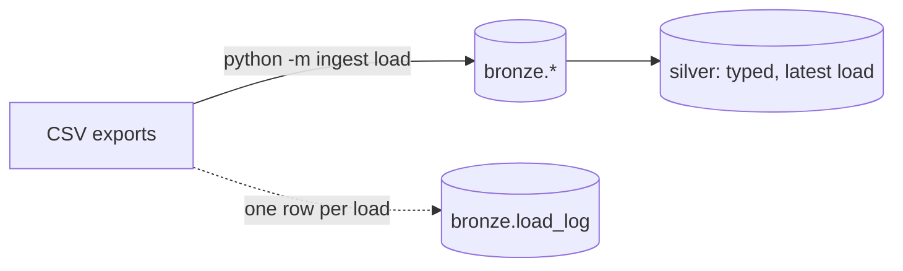

# homelab-dwh


The extract-load stage of a small data warehouse, built from scratch in Python and
PostgreSQL. It takes CSV exports from source systems and lands them in **bronze** tables
exactly as they arrived, with every load recorded so any row can be traced back to the
file and line it came from.



## What it does

- **Bulk loads with `COPY`**, streaming rows instead of inserting them one at a time.
- **Creates tables from the CSV header.** File and column names are normalised into safe
  identifiers (`Student Key` → `student_key`) and quoted with `psycopg.sql`, never
  f-strings.
- **Stores everything as text.** Bronze mirrors the source; types are applied downstream.
- **Is append-only.** A re-export is loaded again rather than overwriting, so history is
  never lost.
- **Records lineage.** Each load gets a row in `bronze.load_log` (file, export time,
  row count), and every bronze row carries `_load_id` and `_source_line`.

## Quick start

Requires Python 3.13, [uv](https://docs.astral.sh/uv/) and PostgreSQL.

```bash
cp .env.example .env              # set DATABASE_URL and TEST_DATABASE_URL
uv sync
uv run python -m ingest init-db   # create the bronze schema and load log (safe to repeat)
uv run python -m ingest load --source cases path/to/students.csv
```

```text
loaded students.csv -> bronze.cases__students (12 rows, load 1)
```

The rows of the latest load of a table, which is where downstream models start:

```sql
select s.*
  from bronze.cases__students s
 where s._load_id = (select load_id from bronze.load_log
                      where table_name = 'cases__students'
                      order by source_modified_at desc, load_id desc limit 1);
```

## Development

```bash
tools/check.sh   # ruff format + lint, strict mypy, real-data guard, pytest
```

Tests run against a real PostgreSQL database (`TEST_DATABASE_URL`), and CI runs the same
script against Postgres 17 on every push. Only invented data is ever committed: CSVs and
dumps are git-ignored, and `tools/check_no_real_data.py` fails the build if one slips in.
